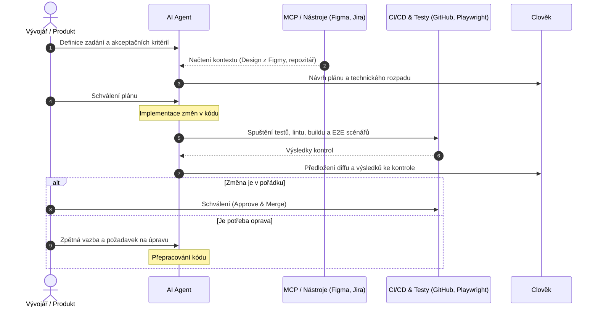

> Nedávno jsem psal o tom, jak pracuji s Claudem. Vývoj AI nástrojů se ale mění tak rychle, že se
> některé detaily mohou za pár měsíců lišit. Tenhle článek píšu hlavně pro budoucího Alfonsa, abych
> si za pár let vzpomněl, jak jsme pracovali „v pravěku“. Jestli někoho inspiruje, tím lépe.

## Od vibe codingu k práci s agenty?

Pamatujete si první vlnu nadšení zvanou _vibe coding_? Sedli jste si s kávou, popsali AI vágní přání
v přirozeném jazyce a sledovali, jak chrlí stovky řádků kódu. A z kvality kódu se mi dělalo mdlo.

Mně osobně tenhle způsob práce od začátku úplně neseděl. Na programování mě baví přemýšlet nad
řešením, napsat ho a sledovat, jak funguje. Když AI vyrobí velkou změť kódu, kterou pak musím
kontrolovat a opravovat, snadno se z vývoje stane spíš revize cizí práce než radost z vlastního
řešení.

To ale neznamená, že _vibe coding_ zmizel nebo že je vždycky špatně. Na prototyp, jednorázový skript
nebo malý experiment může být skvělý. U většího projektu mi víc vyhovuje práce, při které AI dostane
přístup ke konkrétním souborům a nástrojům, může provádět změny a ověřovat je. Tomuto přístupu se
říká **agentic coding**. Není to jen fancy název; jde o smysluplné využívání AI při kódování.

Vývojář přitom nepřestává být vývojářem. Pořád musí rozumět problému, vybírat řešení, kontrolovat
změny a nést odpovědnost za to, co se dostane do projektu. Jen část rutinní práce může přenechat
agentovi.

- SPOILER [Free the Dry Devil](https://www.youtube.com/watch?v=MhEL9cvLxQE)

---

## Praktický životní cyklus úkolu

Agenti nejsou automaticky tým autonomních specialistů. Jsou to modely, kterým konkrétní aplikace
zpřístupňuje kontext a nástroje. V praxi je užitečné začít jednoduchým pracovním postupem a přidávat
další agenty jen tehdy, když řeší skutečný problém.

### 1. Ujasnit zadání

**Vstup:** ticket, popis chyby nebo požadavek od uživatele.

Nejdřív si ujasněte, co má být výsledkem. U složitějšího úkolu stanovte akceptační kritéria, omezení
a věci, které se měnit nemají. Agent může pomoci zadání rozebrat nebo navrhnout plán, ale návrh
zkontrolujte dřív, než začne měnit větší část projektu.

Pokud agent čerpá z Jira nebo Confluence přes MCP, může si načíst příslušné informace. Zápis nových
ticketů nebo změna jejich stavu vyžadují odpovídající nástroje a oprávnění; samotná přítomnost MCP
serveru je nezaručuje.

### 2. Převést design do implementačního zadání

**Vstup:** návrh ve Figmě, existující komponenty a pravidla design systému.

Figma MCP může agentovi zpřístupnit informace o návrhu a v podporovaných klientech také umožnit
práci s obsahem přímo ve Figmě. To může omezit ruční přepisování rozměrů a stylů, samo o sobě to ale
nezaručí přesnou ani hotovou implementaci.

Agent musí návrh propojit s komponentami a konvencemi konkrétního projektu. Výsledné UI je potřeba
spustit a porovnat s designem.

### 3. Implementovat po menších změnách

Kódovací agent může prozkoumat související soubory, navrhnout postup a provést změny. U menšího
úkolu stačí zadat konkrétní výsledek. U většího je lepší nejdřív zkontrolovat plán a pak nechat
agenta postupovat po menších krocích.

Důležité je, aby změna odpovídala projektu: používala existující knihovny, respektovala architekturu
a nezasahovala do nesouvisejících míst. Pravidla projektu tomu pomáhají, ale nejsou zárukou, že
model každé instrukci správně porozumí.

### 4. Ověřit chování

Testy mohou psát stejný agent jako implementaci, jiný agent nebo člověk. Oddělený pohled může pomoct
odhalit chyby, ale sám o sobě testy neudělá nezávislými ani kvalitními.

Testy odvoďte od akceptačních kritérií, spusťte je a zkontrolujte, co skutečně ověřují. Podle
projektu sem patří například:

- unit a integrační testy,
- lint, typová kontrola a build (ano, i dnes),
- E2E scénáře v prohlížeči.

Playwright MCP může ovládat prohlížeč a provést zadané scénáře. Neprovádí však automaticky úplnou
regresní kontrolu: musí dostat konkrétní scénáře a očekávané výsledky.

### 5. Zkontrolovat změnu a rozhodnout o merge

Agent může připravit shrnutí změn nebo návrh pull requestu. GitHub MCP může podle nastavených
oprávnění pracovat s repozitářem, issues a pull requesty. Statickou analýzu a automatické kontroly
obvykle zajišťují nakonfigurované nástroje a CI; MCP je samo od sebe nevykoná.

Před mergem zkontrolujte diff, výsledky testů a případná varování. Odpovědnost za schválení a
nasazení zůstává na týmu.

---

## Zjednodušený diagram



> (drahý příteli, shame on me: jsem liný dodat automaticky rerender mermaid grafu při přepnutí mezi
> dark/light theme... refreshni stránku, pokud to vidíš blbě

Jde o jednu možnou podobu procesu, ne o povinnou sestavu samostatných agentů. U malého úkolu může
celý postup zvládnout jeden agent a člověk, který změnu zkontroluje.

---

## MCP: propojení modelu s nástroji

**Model Context Protocol (MCP)** je standardizovaný způsob, jak AI klientovi zpřístupnit externí
nástroje a data. MCP server může například nabídnout čtení ticketů, práci s repozitářem nebo
ovládání prohlížeče.

MCP server ale neurčuje, kdy a jak agent nástroj použije. Záleží na klientovi, dostupných
nástrojích, oprávněních a instrukcích. Před zapojením proto zjistěte, zda server umí jen číst, nebo
také vytvářet a měnit data.

> MCP je super věc – i když jsem nedávno dělal web pro místního prodejce kebabu, přidal jsem na něj
> MCP, aby u něj mohli AI agenti nakupovat přímo. :-) A ON TO FAKT NĚKDO UŽ POUŽIL! :-D

### Příklady serverů

- [Figma MCP Server](https://developers.figma.com/docs/figma-mcp-server/) — oficiální dokumentace;
  doporučený vzdálený server je `https://mcp.figma.com/mcp`. Přístup se autorizuje přes Figma účet.
- [GitHub MCP Server](https://github.com/github/github-mcp-server) — oficiální server od GitHubu;
  podporuje například práci s repozitáři, issues a pull requesty.
- [MCP Atlassian](https://github.com/sooperset/mcp-atlassian) — komunitní server pro Jira a
  Confluence, není to oficiální produkt Atlassianu.
- [Playwright MCP](https://github.com/microsoft/playwright-mcp) — server od Microsoftu pro ovládání
  prohlížeče pomocí Playwrightu.

Odkazy na konkrétní instalaci se mohou měnit. Před použitím ověřte, kdo server udržuje, jaká
oprávnění vyžaduje a jestli je vhodný pro váš klientský program.

### Příklad vzdáleného Figma MCP v Cursoru

Cursor podporuje MCP konfiguraci v `mcp.json`. Pro vzdálený Figma server může mít základní
konfigurace tento tvar:

```json
{
  "mcpServers": {
    "figma": {
      "url": "https://mcp.figma.com/mcp"
    }
  }
}
```

V Cursoru se potom k serveru připojte a autorizujte Figma účet. Figma doporučuje instalaci svého
Cursor pluginu, pokud je dostupná; plugin přidává také pravidla a instrukce pro práci s designy.
Postup a podporované klienty popisuje
[dokumentace vzdálené instalace](https://developers.figma.com/docs/figma-mcp-server/remote-server-installation/).

Konfigurace ostatních serverů závisí na hostitelské aplikaci a způsobu přihlášení. Nepřebírejte bez
kontroly jeden `mcp.json` pro každý nástroj.

---

## Instrukce pro agenta v projektu

Pravidla mohou agentovi vysvětlit strukturu projektu, používané příkazy a očekávaný styl změn. V
Cursoru jsou současným formátem projektová pravidla ve složce `.cursor/rules`; podporovaný je také
soubor `AGENTS.md`. Starý soubor `.cursorrules` je zastaralý, přesto ho Cursor stále podporuje.

Příklad jednoduchého `AGENTS.md`:

```markdown
# Pokyny pro práci v projektu

## Než začneš

- Prohlédni si soubory přímo související s úkolem.
- Pokud zadání není jednoznačné, nejprve shrň předpoklady a navrhni plán.
- Zachovej stávající architekturu a používej už nainstalované knihovny.

## Při změně

- Omez změny na rozsah zadání.
- Nepřidávej závislosti bez vysvětlení důvodu.
- Testy odvozuj od očekávaného chování, ne jen od současné implementace.

## Po změně

- Spusť relevantní kontroly, které projekt nabízí.
- Ve shrnutí uveď změněné soubory, spuštěné kontroly a jejich výsledky.
- Neprováděj merge ani nasazení bez výslovného schválení.
```

Pravidla mohou zlepšit konzistenci a omezit zbytečné hledání, ale nezaručují menší spotřebu tokenů
ani správné chování. Výsledek je potřeba ověřovat stejně jako každou jinou změnu.

---

## Lokální model přes Ollamu

Lokální model je užitečný pro experimentování, vysvětlování kódu nebo menší úpravy bez odesílání
promptů do externího modelového API. Jeho schopnosti závisí na konkrétním modelu, jeho velikosti a
hardwaru.

Samotný Ollama model není automaticky agent, který bezpečně prochází projekt a upravuje soubory.
Potřebuje klienta nebo rozšíření, které umí pracovat se soubory a případně mu zpřístupní nástroje.
Například Continue podporuje modely přes Ollamu; aktuální YAML konfigurace může vypadat takto:

```yaml
name: Local Ollama
version: 0.0.1
schema: v1

models:
  - name: Local coding model
    provider: ollama
    model: qwen2.5-coder:7b
    roles:
      - chat
      - edit
      - apply
```

Název modelu musí odpovídat modelu dostupnému v místní instalaci Ollamy. Uvedený Qwen je jen
příklad; použijte tag, který máte stažený, a ověřte si, zda daný model podporuje funkce potřebné pro
váš pracovní postup. Schopnost odpovídat v chatu automaticky neznamená schopnost spolehlivě používat
nástroje nebo fungovat jako autonomní agent.

Continue používá YAML konfiguraci jako preferovaný formát. Více je v
[návodu Continue pro Ollamu](https://docs.continue.dev/guides/ollama-guide) a v
[referenci konfigurace](https://docs.continue.dev/reference).

---

## Bezpečnost a oprávnění

MCP server může agentovi zpřístupnit firemní dokumenty, zdrojový kód nebo možnost něco změnit.
Proto:

- používejte jen server, jehož původ a údržbě důvěřujete;
- dávejte mu pouze potřebná oprávnění, ideálně začněte přístupem pro čtení;
- tajné tokeny nevkládejte do repozitáře ani do veřejně sdílené konfigurace;
- před zápisem do Jira, GitHubu nebo Figmy zkontrolujte, jaké operace server umožňuje;
- obsah z ticketů, webů a repozitářů berte jako data, ne jako automaticky důvěryhodné instrukce.

---

## Závěrem

Agentic coding není konec programování ani kouzelný tým specialistů na jedno kliknutí. Je to způsob,
jak modelu bezpečně zpřístupnit konkrétní část projektu a případně nástroje, které mu pomohou
vykonat práci.

Nejlépe mi funguje začít jasným zadáním, nechat agenta udělat omezenou změnu a potom ověřit diff i
chování programu. Více agentů a MCP integrací má smysl přidávat až ve chvíli, kdy zjednoduší
konkrétní část skutečného procesu.

## P.S: Trocha pokročilé automatizace

Ještě bych rád upozornil na jeden roztomilý automatizační nástroj, který vám může práci v procesu
VELMI usnadnit: [n8n](https://n8n.io/). Určitě jich dnes existuje spousta. Pokud se náhodou stane,
že to tu někdo bude číst, klidně mi napište, co používáte vy. :-)
